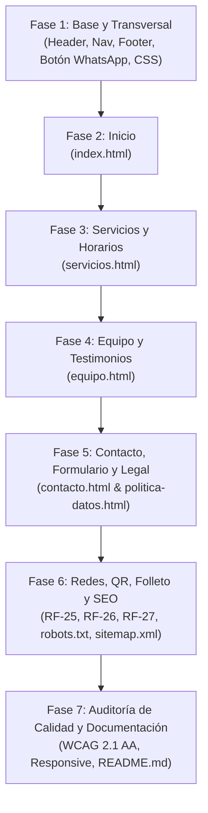

# Plan de Implementación: Plataforma Web Informativa de Open Brain

> Documento maestro de planificación técnica para el desarrollo de la plataforma web de Open Brain (Cúcuta, Colombia).
> Cumple rigurosamente las reglas del proyecto (`docs/00-reglas.md`), las decisiones técnicas (`docs/02-requerimientos-funcionales.md` y `docs/03-stack.md`), la identidad visual (`docs/04-identidad-visual.md`) y el marco legal aplicable (`docs/05-legal.md`).

---

## 1. Objetivos y Alcance

### Objetivo General
Desarrollar una plataforma web informativa y accesible para la difusión de la oferta académica de Open Brain, centralizando en un único punto de acceso la información institucional, catálogo de servicios y canales de contacto directo para la recepción de solicitudes de inscripción.

### Alcance
- Cuatro módulos informativos principales (`index.html`, `servicios.html`, `equipo.html`, `contacto.html`).
- Una página de soporte legal (`politica-datos.html`).
- Canal directo de mensajería mediante botón flotante de WhatsApp.
- Formulario de solicitud de inscripción procesado por Web3Forms con validación en cliente.
- Cumplimiento de los 27 requerimientos funcionales (`RF-01` a `RF-27`).
- Recursos institucionales: enlaces a redes sociales, folleto PDF descargable, código QR vectorial para la sede física.
- SEO técnico: `robots.txt`, `sitemap.xml`, metaetiquetas Open Graph y canonical en todas las páginas.

### Límites Estrictos y Fuera de Alcance
- **No matricula:** La plataforma no realiza matrículas ni reservas de cupos automáticas. Solo recibe solicitudes y orienta los pasos.
- **Sin pagos en línea:** No hay pasarelas de pago ni cobros digitales.
- **Protección estricta de menores (Ley 1581 de 2012 y Ley 1098 de 2006):** Ninguna imagen de menores, ningún dato de menores en formularios, y testimonios autorizados sin nombres de niños o niñas.
- **Sin bases de datos ni backends propios:** HTML5, CSS3 y JavaScript puro (ES6+). Alojamiento estático en Cloudflare Pages.

---

## 2. Decisiones de Stack y Simulación

1. **Stack puro:**
   - HTML5 semántico (un solo `<h1>` por página, `<header>`, `<nav>`, `<main>`, `<section>`, `<footer>`, `
`/`
`).
   - CSS3 mobile-first con variables `:root` extraídas del moodboard (`#2F438C`, `#5EC3CC`, `#E36B6F`, `#FEAFCF`, `#F86DC1`, `#1B2340`). Breakpoints en `768px` y `1024px`. Sin scroll horizontal desde `320px`.
   - JavaScript modular puro (ES6+): `js/menu.js` para navegación móvil accesible y `js/formulario.js` para gestión del formulario.
   - Tipografía: Google Fonts **Nunito** (sans-serif amigable, redondeada y de alta legibilidad).
2. **Modo Simulación de Web3Forms:**
   - En `js/formulario.js` se definirá `const MODO_SIMULACION = false;` (**desactivado por defecto**).
   - De esta forma, el código entregado siempre intenta el envío real a `https://api.web3forms.com/submit`.
   - Se documentará en el `README.md` cómo activarlo temporalmente durante pruebas locales (`true`) y cómo verificar que quede en `false` antes de la entrega final.
3. **Marcadores `[PENDIENTE: ...]`:**
   - Todo dato no suministrado por Open Brain (teléfonos reales, correo definitivo, access key de Web3Forms, tarifas exactas, testimonios definitivos, fotos de sede sin menores) se mantendrá con un marcador visible en la interfaz o en el código según corresponda, sin inventar datos.

---

## 3. Desglose de Fases de Implementación

---

### Fase 1: Arquitectura Base, Sistema de Diseño y Componentes Transversales
- **Objetivo:** Establecer la estructura de carpetas, el sistema de diseño CSS (`css/estilos.css`), el comportamiento del menú responsive accesible (`js/menu.js`), los isotipos SVG del logo y la mascota, la barra de navegación transversal y el botón flotante de WhatsApp.
- **Archivos:**
  - `css/estilos.css` (variables de color, tipografía, utilidades accesibles, reset, layout, botón flotante, header/nav común)
  - `js/menu.js` (toggle de menú móvil con control ARIA `aria-expanded`, navegación por teclado, cierre con tecla Escape)
  - `img/logo-openbrain.svg` (isotipo representativo según especificación del moodboard)
  - `img/mascota-openbrain.svg` (ilustración del cerebro con lentes para identidad visual)
- **RFs cubiertos:**
  - `RF-01`: Barra de navegación en todas las páginas con logo y enlaces a los 4 módulos.
  - `RF-02`: Botón flotante accesible de WhatsApp con enlace `https://wa.me/57[PENDIENTE]`.

---

### Fase 2: Módulo de Inicio (`index.html`)
- **Objetivo:** Construir la portada informativa de Open Brain con tono cálido y profesional, bienvenida contextualizada en Cúcuta, presentación institucional, reserva de imagen de la sede y llamadas a la acción directas.
- **Archivos:**
  - `index.html`
  - `css/estilos.css` (estilos de hero, presentación, espacio de sede, accesos rápidos)
- **RFs cubiertos:**
  - `RF-03`: Mensaje de bienvenida sobre el apoyo a dificultades de aprendizaje en Cúcuta.
  - `RF-04`: Presentación de Open Brain (quiénes son y qué hacen).
  - `RF-05`: Espacio con imagen de la sede (sin menores, con `width`, `height`, `alt`).
  - `RF-06`: Botón de acción "Ver servicios" hacia `servicios.html`.
  - `RF-07`: Teléfono y correo visibles de la organización.
  - `RF-08`: Tres accesos directos a cada servicio enlazando a `servicios.html#pedagogico`, `#terapeutico`, `#estimulacion`.

---

### Fase 3: Módulo de Servicios y Horarios (`servicios.html`)
- **Objetivo:** Publicar la oferta académica y terapéutica completa, estructurando de forma clara las modalidades, edades atendidas, tablas/tarjetas de horarios y tarifas con sus notas aclaratorias.
- **Archivos:**
  - `servicios.html`
  - `css/estilos.css` (estilos de catálogo, badges de edad/modalidad, tablas de horarios y tarifas, layout desktop con barra lateral)
- **RFs cubiertos:**
  - `RF-09`: Tres servicios detallados (acompañamiento pedagógico, acompañamiento terapéutico y estimulación adecuada).
  - `RF-10`: Edades y modalidades por cada servicio.
  - `RF-11`: Horarios de atención organizados para consulta rápida.
  - `RF-12`: Tarifas de los servicios con marcadores `[PENDIENTE: Tarifas]`.
  - `RF-13`: Botón "Solicitar información" en cada servicio que redirige a `contacto.html`.

---

### Fase 4: Módulo de Equipo y Testimonios (`equipo.html`)
- **Objetivo:** Brindar seguridad y empatía a las familias mediante la presentación de los profesionales de Open Brain, testimonios conformes a la Ley 1581 y preguntas frecuentes interactivas nativas.
- **Archivos:**
  - `equipo.html`
  - `css/estilos.css` (tarjetas de equipo, bloques de testimonios con citas, acordeones semánticos `
`)
- **RFs cubiertos:**
  - `RF-14`: Presentación del equipo profesional (3 profesores).
  - `RF-15`: Testimonios de familias que cuentan con autorización previa, sin nombres de menores.
  - `RF-16`: Preguntas frecuentes implementadas exclusivamente con `
` y `
` (accesible y funcional sin JS).

---

### Fase 5: Módulo de Contacto, Solicitud de Inscripción y Soporte Legal (`contacto.html`, `politica-datos.html`, `js/formulario.js`)
- **Objetivo:** Implementar el canal digital de recepción de solicitudes de inscripción con formulario accesible, validación estricta de consentimiento, integración con Web3Forms, mapa interactivo, pasos del proceso y política de privacidad completa.
- **Archivos:**
  - `contacto.html`
  - `politica-datos.html` (página de apoyo con la política de tratamiento de datos según Ley 1581)
  - `js/formulario.js` (validación en cliente, honeypot, gestión de envío `fetch` con `MODO_SIMULACION = false;` por defecto y mensajes en pantalla)
  - `css/estilos.css` (layout responsive de contacto: formulario + mapa y datos en escritorio, columna única en móvil)
- **RFs cubiertos:**
  - `RF-17`: Formulario con nombre del acudiente, teléfono o correo, servicio de interés y mensaje.
  - `RF-18`: Casilla de aceptación de tratamiento de datos obligatoria con enlace a `politica-datos.html`; bloquea el envío si no está marcada.
  - `RF-19`: Envío del formulario asíncrono con `fetch` a Web3Forms al correo de Open Brain `[PENDIENTE]`.
  - `RF-20`: Mapa insertado (iframe) con la dirección y enlace "Cómo llegar".
  - `RF-21`: Dirección (CL 2N N.º 14E-102, Villa Prado, Cúcuta), teléfono, correo y horario de atención visibles.
  - `RF-22`: Explicación de los pasos para solicitar la inscripción (aclarando que no se matricula en línea).
  - `RF-23`: Mensaje destacado invitando a consultar cupos por WhatsApp.
  - `RF-24`: Respuesta automática en pantalla al enviar el formulario (mensaje de éxito/error accesible con `aria-live`).

---

### Fase 6: Canales Institucionales, Recursos Descargables y SEO Técnico
- **Objetivo:** Incorporar los recursos transversales de difusión y presencia institucional, folleto PDF, código QR para la sede física y optimización para motores de búsqueda (SEO).
- **Archivos:**
  - `assets/folleto-open-brain.pdf` (documento informativo institucional listo para descarga)
  - `assets/qr-openbrain.svg` (código QR vectorial accesible para impresión o exhibición en sede)
  - `robots.txt` (configuración de rastreo e indexación para buscadores)
  - `sitemap.xml` (mapa del sitio con las 5 URLs públicas canónicas)
  - `index.html`, `servicios.html`, `equipo.html`, `contacto.html`, `politica-datos.html` (inclusión de enlaces a redes sociales, enlace al folleto, meta tags Open Graph, Twitter Cards, canonical y descriptions únicas)
  - `css/estilos.css` (estilos para iconos de redes sociales y bloque de descarga de folleto)
- **RFs cubiertos:**
  - `RF-25`: Enlaces a redes sociales de Open Brain con marcadores `[PENDIENTE: URL]`.
  - `RF-26`: Código QR vectorial que dirige a la web para uso en la sede.
  - `RF-27`: Folleto digital descargable (`assets/folleto-open-brain.pdf`).
  - SEO técnico: `robots.txt`, `sitemap.xml`, metaetiquetas SEO y Open Graph completas.

---

### Fase 7: Auditoría de Calidad, Accesibilidad (WCAG 2.1 AA), Responsividad y Documentación
- **Objetivo:** Comprobar la calidad total del proyecto en resoluciones móviles y de escritorio, verificar contraste de colores, navegación por teclado, código limpio sin `console.log` y elaborar el manual técnico en `README.md`.
- **Archivos:**
  - `README.md`
- **Entregables:**
  - Matriz de verificación de los 27 requerimientos funcionales (`<!-- RF-xx -->`).
  - Validación responsive en 320px, 375px, 768px, 1024px y 1280px sin scroll horizontal.
  - Comprobación de contrastes WCAG 2.1 AA y áreas táctiles de al menos 44 px.
  - `README.md` completo: cómo ejecutar en local, cómo desplegar en Cloudflare Pages, cómo activar/desactivar la simulación de Web3Forms, cómo configurar las credenciales reales y cómo actualizar contenidos.

---

## 4. Definición de Terminado (DoD)
- Los 27 RF cubiertos e identificados en el código mediante comentarios `<!-- RF-xx -->`.
- Sin frameworks, bundlers ni librerías JS/CSS externas.
- Validación mobile-first sin desbordamientos ni scroll horizontal desde 320 px hasta 1280 px+.
- Accesibilidad WCAG 2.1 AA: contraste verificado, textos alternativos en imágenes, navegación fluida con teclado y foco visible.
- Cero llamadas a `console.log` o código muerto en la versión final.
- `README.md` detallado y listo para transferencia técnica al equipo de Open Brain.
